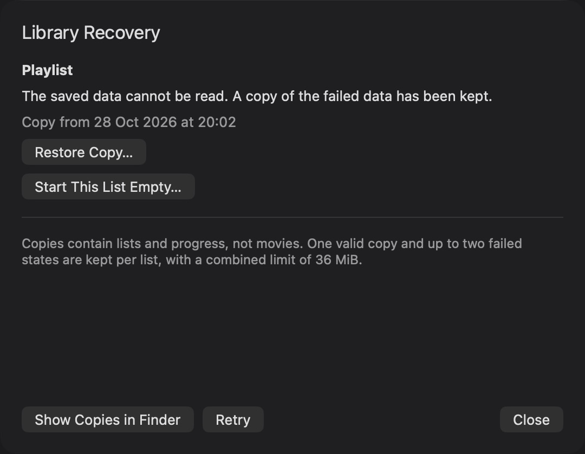
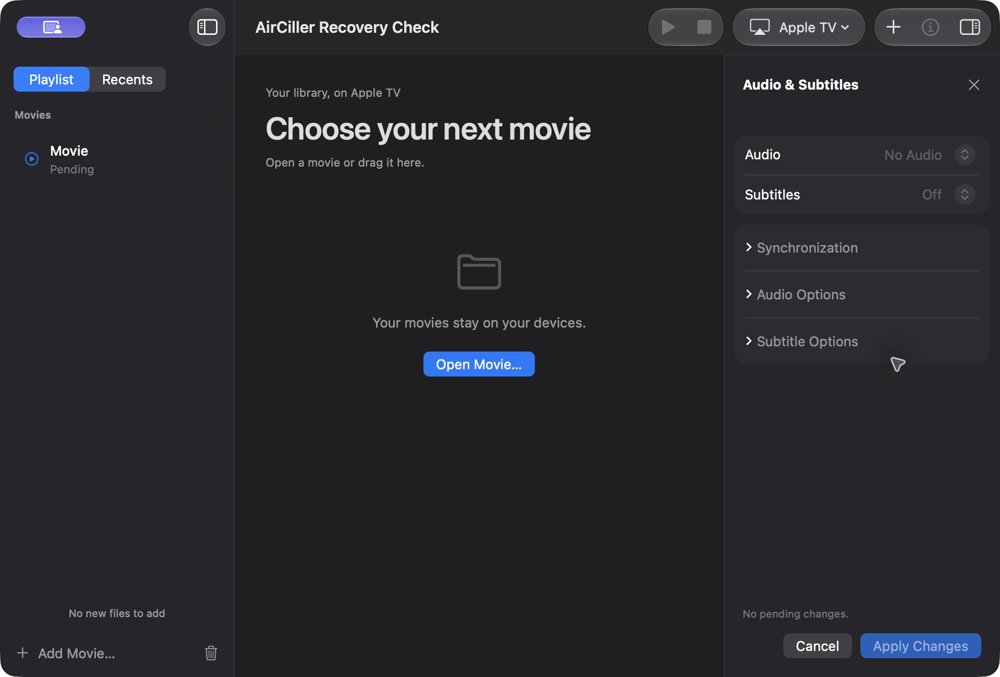

# Library reliability candidate

Started 28 October 2026 from main `09bb3ee`, after the 0.18.2 publication.
This work permits a candidate and PR, not a release, daily installation or
private-service deployment. Status: local and native checks complete; PR CI pending.

## Selected validation

The selected boundary is library persistence and import feedback. Neither media
packager, playback engine, track conversion nor receiver transport is being
changed. Use isolated preferences and temporary synthetic libraries. Required
checks are focused storage/coordinator regressions, native recovery/import
interaction, both languages, and the strict full local gate on the final code.
No Apple TV session is selected. Reassess if a change actually reaches playback.
Local and native acceptance are recorded below. PR CI remains separate.

## Findings and decisions

| Idea | Evidence and benefit | Risk / effort / maintenance | Check and decision |
| --- | --- | --- | --- |
| Preserve unreadable library data and offer explicit recovery | HistoryStore removes malformed Playlist and Recents bytes immediately; season decoding falls back to empty. Existing tests require that deletion. A valid checkpoint and a separate failed record protect order/progress without touching media. | Medium / moderate / one small storage boundary | Implement priority. Test repeat failure, malformed and newer records, bounded storage, permissions, interrupted writes and explicit restore; no real preferences |
| Report standalone duplicate imports | handleURLs clears the receipt, then enqueue silently deduplicates. A repeated file drop can look ignored even though the item is present. | Low / small / existing receipt | Candidate extra 1. Reproduce with isolated coordinator before changing; inspect the real sidebar |
| Count standalone files in a mixed folder import | importLibraryFolders admits standalone files before setting importedFileCount to zero. Its final count includes only folder additions. | Low / small / same import receipt | Candidate extra 2. Reproduce mixed input and duplicates; no admission or playback changes |
| Automatically relink missing paths | Explicit Locate File already preserves order and progress and rejects duplicate destinations. Similar names do not prove identity. | High / moderate / ongoing matching policy | Reject automatic relinking. Retain the existing deliberate action |
| Reuse track-conversion consent across episodes | The scoped session consent already checks compatible codec/profile/layout/rate/precision; Stop clears it. A global remembered approval would hide a new lossy conversion. | High / moderate / audio policy | No new change. Preserve the existing explicit scope |
| Add another cancel/retry control | Folder scans have cancellation and identity checks; track drafts already reject stale and unchanged Apply. No missing control established in inspected paths. | Medium / moderate / duplicate state | Investigate only after a concrete reproduction; no new control now |
| Rework episode selection/progress | Native selection is already distinct from playback, with watched state and progress preserved through Undo. This review has no reproduction justifying another redesign. | Medium / large / native focus behavior | Retain current design; keep existing regression coverage |

The combined production-coordinator regression failed before the receipt changes
and passes with them. Mixed file/folder admission reports two additions; dropping
the existing standalone file explains that there is nothing new to add, without
changing membership or starting media analysis. They share one existing message
surface and do not add settings or panels. Native receipt presentation also passed.

## Recovery design

Keep the current library representation while adding bounded local recovery
records. A known-valid checkpoint and the failed raw data serve different
purposes: the former can restore usable entries, the latter preserves evidence
and potentially recoverable fields. Never infer that malformed data means the
user requested an empty library.

The first isolated component writes fixed, atomic binary-plist records. Each
record has a schema version, collection, date and unmodified payload. It rejects
unknown versions, malformed records, unsafe paths and oversized input. Its
three collections each have checkpoint, current-incident and previous-incident slots:
at most 36 MiB of owned records, plus one 4 MiB atomic replacement. It does not
delete files by age or scan unrelated folders. An unresolved incident cannot be
replaced. After explicit recovery, a new failure retains the preceding resolved
incident before writing the new one. Only the oldest resolved incident ages out;
the valid checkpoint is separate. Live unreadable data remains untouched when
preservation cannot complete.

The service checkpoints valid data on inspection, intended for startup and
explicit recovery refresh. It does not copy each five-second progress save.
HistoryStore now preserves unreadable preference bytes and refuses subsequent
ordinary saves to those collections. The explicit recovery service rechecks the
original value and selected checkpoint before replacing one collection. The
coordinator exposes a non-modal recovery notice, disables library edits while
data is unreadable, and offers a dated explicit restore or an empty-list choice
after preservation. Valid lists are not replaced during another list's recovery.
UserDefaults does not provide a transactional disk-write acknowledgement.
Recovery-file write failures are reported; an in-memory preferences read does
not prove a durable disk commit. This change does not migrate the live library
to a new database or promise protection against every storage failure.

For the UI, follow [Apple's alerts guidance](https://developer.apple.com/design/human-interface-guidelines/alerts):
show a discoverable recovery status instead of a startup modal, and confirm an
explicit restore with its scope and date. Restore must not silently replace
newer changes. The user can cancel. Normal successful imports use the existing
sidebar receipt and do not need an alert.

## Evidence

`LibraryRecoveryArchiveSmokeTest` passes in strict Swift 6 with warnings as
errors. It checks all three independent collections, preserved incident date
and bytes, checkpoint freezing, refused second incidents, injected ENOSPC and
permission failures, retained prior bytes, size limits, unsupported schema,
malformed records, collection isolation, symlink rejection and reload of a
previous-incident record. This exercises the storage component only. Injected write
failure is not a real power-loss test. Retention tests cover three resolved
incidents, fixed slot counts, and checkpoint refresh after explicit recovery.

HistoryStore's focused regression now verifies byte preservation and refused
ordinary overwrites for all three unreadable collections. LibraryRecoverySmokeTest
passes startup with absent/current data, partial and total corruption, explicit
restoration of progress and season expansion, stale-prompt rejection, a second
failure after recovery, blocked replacement of an unresolved failure, archive
limits and distinct unrecognized-format reporting. Both suites use isolated
preferences and temporary synthetic data. An interrupted restore is simulated
between marking the incident resolved and changing preferences; inspection
reopens the incident and preserves the original data.

No installed app, real library, media, credential or service has been modified.

The coordinator recovery integration passed locally: startup exposes unreadable
data, import/clear/activation do not conceal it, busy restoration is refused,
and idle restoration updates the real coordinator without starting playback.
Native checks in the isolated RecoveryUICheck app observed the notice, dated
confirmation, Cancel preserving the pending issue, successful restore and the
two original synthetic rows with saved progress at 02:00. The final native
candidate also passed English text/layout, explicit empty-list recovery,
re-enabled import actions, adding a standalone file and adding it again without
a duplicate row. The receipt says "1 file added", then "No new files to add".
Mixed file/folder counting is established by the production-coordinator test;
native multi-selection automation did not establish that specific gesture.
The first
harness build used the playback-check flag and failed on its missing tracing
type; the corrected harness uses a dedicated entry-point flag, with no playback
test hooks. The failed build log remains retained.

The isolated production-coordinator suite passed after the two receipt fixes.
Its failed baseline is retained in `.build/library-receipts-baseline.log`; the
successful candidate is `.build/library-receipts-candidate.log`. Existing season,
Undo, import cancellation, selection and control simulations ran in the same
suite. These are local simulations, not fresh receiver evidence.

### Final local gate

The full strict check passed every code test and tool-compilation stage, then
stopped on a documentation wording rule. The original log is
`.build/library-recovery-full-gate.log`. After the prose-only correction, the
remaining check.sh commands from publication validation onward passed in
`.build/library-recovery-gate-remainder.log`, ending with
`AirCiller local checks: OK`. This includes the strict Swift 6 application build,
warnings-as-errors, bundle checks, signature verification and Python packaging.
No code or executable input changed between these two parts.

The installed executable still matches the starting SHA-256
`045cea170ee54e8d192ec54b4e8c1b5f6ad31ba76218a628b04ab31f30e4726b`
and remains 0.18.1. The latest public release remains 0.18.2. Tests use isolated
preferences and synthetic files; no daily library, media, credentials or service
configuration was changed. The native test apps are closed.

### Playback boundary and limits

Compared with main `09bb3ee`, both packagers, media helpers, pinned runtimes and
dependencies are unchanged. Coordinator changes concern library recovery,
blocking edits/activation only while unreadable data is unresolved, and import
receipts. Normal playback authorization, preparation, seek, subtitles, audio
conversion and transport are unchanged; the local coordinator suite checks the
new guard and unchanged ordinary flows. No receiver session is required by
TESTING.md for this library boundary. Earlier 0.18.2 playback evidence remains
historical; this review makes no new audiovisual, HDR or Atmos claim.

Recovery checkpoints are taken at startup or explicit refresh, not continuously.
Recent progress after a checkpoint can be missing from that copy; the restore
confirmation explains this. Empty recovery is an explicit replacement of the
selected list. Over-limit data and unreadable recovery archives remain intact
and require manual inspection; the app never truncates them to make a test pass.
Native checks used the current Mac in dark appearance, not every supported OS
or accessibility setting. No performance improvement is claimed in this delivery.

### Native captures

These are production views in an isolated app, with synthetic library data.

