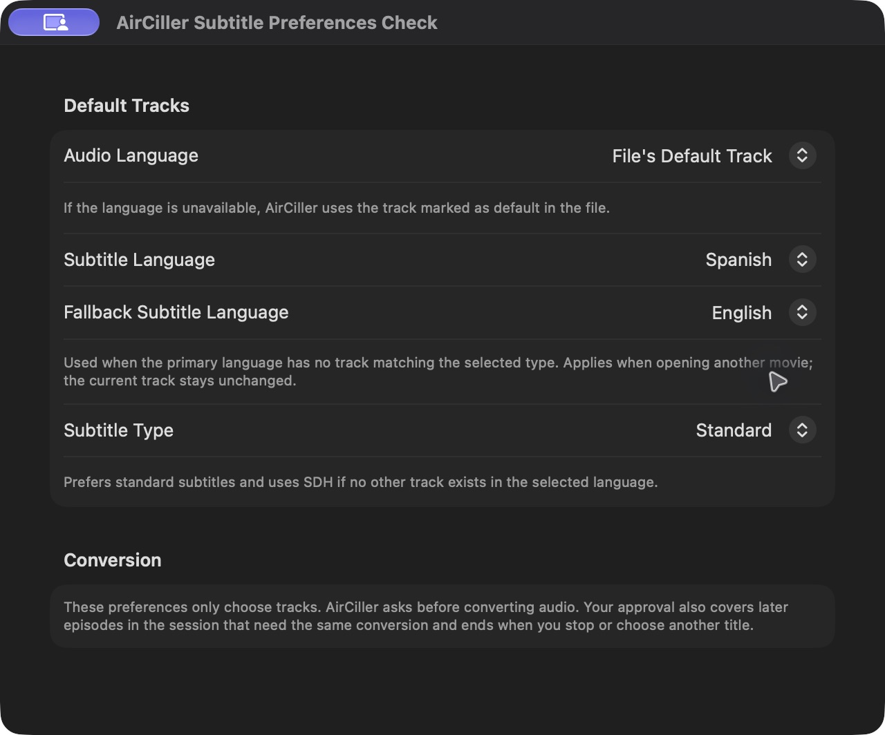
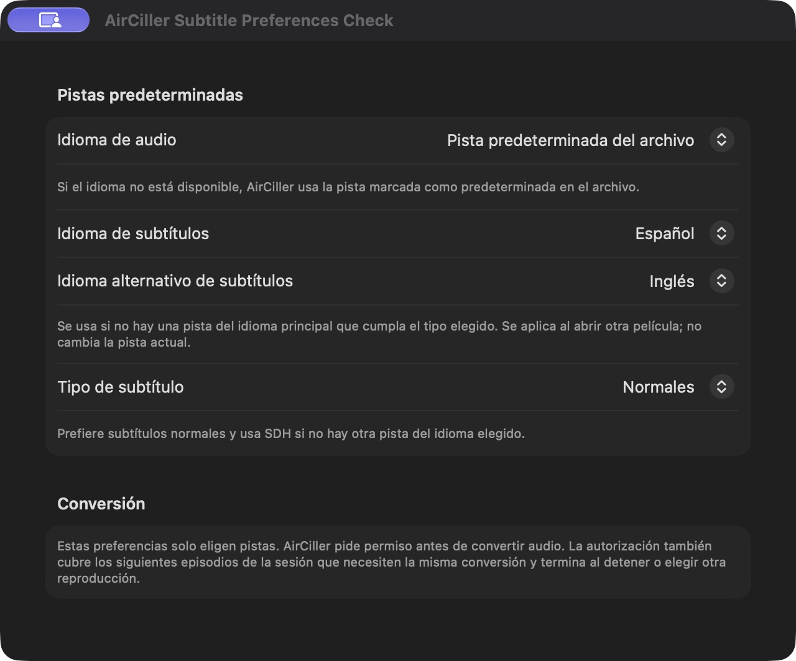

# Nuvio product review

30 October 2026. Starting point: AirCiller `6b1494a`, published and installed
0.18.3. The checkout was clean. PRs #43 and #44 are unrelated dependency proposals.
This scope permits a candidate and PR, not merge, publication, daily installation
or private-control deployment.

## Sources and evidence level

Read source and release metadata only; no Nuvio code was executed or installed.

| Project | Inspected revision | Published release reported by GitHub |
| --- | --- | --- |
| [NuvioTV](https://github.com/NuvioMedia/NuvioTV) | `d063618d20978553c5310162793cd2f26b3cd1bb` on dev | 1.0.0; tag resolves to `9f17e8bf4abc799dc8c832d2894a8b3b166e4353` |
| [NuvioMobile](https://github.com/NuvioMedia/NuvioMobile) | `10feb659ae3368008a584316bd5e1d2665e3aa6c` on cmp-rewrite | 0.6.5-beta |
| [NuvioDesktop](https://github.com/NuvioMedia/NuvioDesktop) | `e33e19befa6f3a9fd7e4fdb48a5fa6cfca39459f` on Dev | 0.1.33-alpha |

The [website](https://nuvio.tv/) advertises artwork, ratings, subtitles and
cross-device progress. These are product claims, not observed runtime acceptance.
Desktop's inspected README explicitly describes an alpha intended for testers.
The behaviors below are established in inspected TV development source, not
certified here for every released Nuvio binary or platform.

## Comparison and selection

| Opportunity | Nuvio source evidence | Existing AirCiller behavior and proposed difference | Benefit / effort / risk / maintenance | Added cost and acceptance |
| --- | --- | --- | --- | --- |
| Local opening/recap skip | [ChapterSkipIntervals](https://github.com/NuvioMedia/NuvioTV/blob/d063618d20978553c5310162793cd2f26b3cd1bb/app/src/main/java/com/nuvio/tv/ui/screens/player/ChapterSkipIntervals.kt) recognizes named chapter segments and excludes post-credits labels | AirCiller probes chapters and offers previous/next chapter. Two local anime episodes inspected with bundled ffprobe had only generic Chapter N labels; one had just one chapter. No reliable intro boundary is established | Potentially useful / moderate / high false-positive cost / naming policy | Defer. No scan, API or heuristic added. Revisit with a useful file carrying explicit labels; never infer an opening from chapter number or duration alone |
| Continue a season | [PlayerNextEpisodeRules](https://github.com/NuvioMedia/NuvioTV/blob/d063618d20978553c5310162793cd2f26b3cd1bb/app/src/main/java/com/nuvio/tv/ui/screens/player/PlayerNextEpisodeRules.kt) resolves subsequent episodes and guards end/post-credit presentation | AirCiller already saves progress, marks watched episodes and advances in the chosen Playlist order. A season-level Continue action would need an explicit policy for manual order, specials and mixed watched state | Useful / moderate / medium / another activation policy | Defer, not a playback rewrite. Would need isolated membership/order/progress tests and a scoped control check |
| Second subtitle language | [PlaybackSubtitleSettings](https://github.com/NuvioMedia/NuvioTV/blob/d063618d20978553c5310162793cd2f26b3cd1bb/app/src/main/java/com/nuvio/tv/ui/screens/settings/PlaybackSubtitleSettings.kt) exposes preferred and secondary languages | AirCiller has one language and normal/SDH/forced ranking. If that language has no eligible track, selection is nil. Add one optional fallback language, default empty | Direct everyday value / small / low-medium / one preference and existing selector | **Select as the only improvement.** No dependency or traffic, one small preference value. Test language priority, eligibility, type ranking, disabled auto-selection, manual choices and isolated persistence |
| Readable episode presentation | Nuvio website and platform READMEs describe a metadata-rich library | AirCiller retains filenames, season groups and progress. Online artwork/matching would add requests, cache and identity correction; filename parsing alone can still misidentify special editions | Useful with a demonstrated example / moderate / medium / parsing and overrides | Defer. Do not rename media or add automatic metadata requests |
| Local renderer or cloud library | Platform trees include player-specific components and website describes account sync | AirCiller sends prepared media to an Apple TV-owned player. A local renderer does not extend receiver capabilities | No demonstrated gain here / large / high / new engines or accounts | Reject for this delivery. No mpv/libass import, source addons, cloud sync or permanent services |

## Selected behavior and validation plan

Add an optional fallback language in Settings > Playback. It applies only when
the primary language is enabled and has no selectable track satisfying the
existing type policy. Evaluate languages in order, then retain the current
normal/SDH/forced ranking within that language. No unrelated language is enabled.
Default-empty fallback preserves existing installations. Changes apply to a
new file analysis, not an already selected or playing track. Explicit per-session
remote language choices retain their existing scope; no connector protocol or
deployment is changed.

Use isolated preferences and synthetic tracks for selection, persistence and
manual-choice regressions, then inspect the real Settings view in English and
Spanish. Run the strict full local gate once on the final code and required PR
CI. Since startup subtitle selection changes, choose a short affected receiver
case only after availability is confirmed; do not repeat HDR, pause, OCR or
format campaigns with unchanged inputs. No packager, engine, HTTP or transport
change is planned. Preserve daily library, preferences, installed app and media.

Implementation is independent Swift code using AirCiller's existing selector.
No Nuvio code, assets or identity are copied. References explain the design idea.
Native controls follow the existing Settings form and Apple's
[button guidance](https://developer.apple.com/design/human-interface-guidelines/buttons).

## Acceptance

The candidate adds one optional preference, empty by default. No extra feature
was selected. Existing aliases/title matching, track names and normal/SDH/forced
ranking are retained. An eligible primary-language bitmap track still wins over
a cheaper text fallback. Forced-only never enables full subtitles; if neither
language has an eligible track, selection remains off. Explicit command-line
track selection retains its existing higher-priority branch.

`SubtitleFallbackSmokeTest` passes ordered-language, unavailable/unsupported
tracks, aliases, title matching, same-language, empty/invalid alternative,
normal/SDH/forced and unchanged-default cases. The production coordinator test
passes selection, reload persistence, disabled automatic subtitles, retained
manual/active track and explicit remote-session scope. These are isolated local
checks, not receiver output. No private connector fields or services changed.

Native inspection uses the production PlaybackSettingsView in a UUID-suffixed
test app at the actual 640 x 500-point Settings content size. On macOS 27.2
(26B123), English and Spanish show the primary and fallback controls and complete
explanations. Selecting English persists across relaunch. Disabling automatic
subtitles disables the fallback and type controls without discarding their saved
values; enabling it again restores availability. Actual screenshots use isolated
preferences and contain no library or device data. Current dark appearance was
inspected; no older-OS or full accessibility-matrix acceptance is claimed.

The first menu-selection automation was interrupted by a reported UI-state
change; a fresh state and subsequent interaction established the expected result.
This was not treated as a passing action before the control value changed.

## Final checks and limits

The strict full local gate passed in `.build/subtitle-fallback-full-check.log`,
including the ordinary strict Swift 6 application build, warnings-as-errors,
bundle signatures and the 165 MB size gate. The bundle is 145,998,825 logical
bytes. The first attempt stopped at formatting before code compilation; its log
is `.build/subtitle-fallback-format-failure.log`. Formatting was corrected with
the project tool, not by relaxing checks. PR CI remains a separate required check;
its final commit and result are authoritative on the PR.

The maintainer confirmed that the Apple TV was awake and free. Only the already
approved exact digital screen/audio source was used. The candidate was built as
the isolated AirCiller Test app, executable SHA-256
`787187725c823e9405c41d57465d1ff65d18cc78fb6c3527911d443e91c4d841`.
No new pairing, permission or credential-store change was made.

The two short fixtures contain an English embedded SRT and no Spanish track.
The candidate was launched with primary Spanish and fallback English. Native
Open Movie analysis selected the original `English verification` track without
using a track index override, clicking the subtitle selector or adding an
external subtitle. Playback then used the ordinary Play command. The first
fixture is a synthetic SDR pattern and tone. The HDR fixture copies encoded HDR
video from a local source and adds a synthetic stereo test tone; it is not an
Atmos or original-audio qualification. No original file was modified.

| Scoped observation | Evidence |
| --- | --- |
| SDR HLS with automatic fallback | Complete, source-verified digital capture; 44 expected-cue frames over 25.54 seconds, all with central motion; 121 of 123 audio measurements in that cue span were non-silent. The actual served resource was master.m3u8. Native Stop returned to Ready |
| Direct MP4 with automatic fallback | Final complete, source-verified digital capture; 51 expected-cue frames over 26.23 seconds, 50 with central motion; 123 of 126 audio measurements in that span were non-silent. Native playback advanced and Stop returned to Ready; the direct route's served asset was movie.mp4 |
| Matched Stop/replay control | Baseline Sources from `6b1494a` and current Sources were compiled separately with the same isolated coordinator harness, bundled helpers and signing boundary. Both selected embedded English stream 2, played to 37 seconds, stopped and confirmed playing again. Baseline used primary English; candidate used primary Spanish/fallback English. These are receiver observations, not captured replay output |

Counts describe observed cue spans, not an independently timed whole-playback
window. They establish sampled moving picture, digital audio and the selected
subtitle, not physical speakers, television HDR rendering, frame-accurate sync
or whole-movie reliability. No unrelated long-pause, OCR or format campaign was
repeated. The actual native settings checks and captured selection checks cover
the changed boundary; no native Apple TV overlay or new Dot command was added.

### Preserved failed attempts

- Fixture preparation first used the minimal bundled FFmpeg to generate a tone;
  it has no lavfi input. The explicitly selected development encoder now creates
  synthetic inputs only. A second preparation was refused because the tone was
  mono; it was generated in stereo to meet the unchanged fixture validator.
- The first SDR capture completed and retained its analysis. A private helper
  then tried to print a dictionary field from the analyzer's list output. The
  failed helper and original capture remain retained; SDR was not replayed.
  Reading the retained records established the scoped counts above. This is an
  offline assessment, not a new capture or a successful overall helper run.
- During the first manual HDR Stop/replay check, the app timed out waiting for
  receiver confirmation. That wait and manual observation exhausted the fixed
  capture limit; its manifest is incomplete and is **not** accepted as a passing
  capture. Partial observed cues do not replace capture completion.
- A copied baseline UI did not establish file-opening interaction through the
  automation. The comparison therefore used the real coordinator directly,
  retaining separate baseline and candidate records. Both matched control runs
  passed. This narrows the observation but does not establish the cause of the
  earlier manual timeout or prove it fixed. A subsequent
  [scoped investigation](RELEASE_0.18.4.md) reproduced and corrected overlapping
  helper retirement and passed a directed digital Stop/replay check on both
  paths. The original receiver timeout is still not root-caused.
- One bounded final HDR capture separated the short output observation from
  replay diagnosis and completed within the unchanged limit. No capture bound,
  assertion, source policy or application timeout was increased.

Private runs are `capture-run-nuvio-t8niuqq5`, `capture-run-nuvio-8l6ztrjh`,
`capture-run-nuvio-opwcgxpm`, `capture-run-nuvio-j46kxc9a` and
`capture-run-nuvio-las59f5p` under `.build/playback-checks`. The last run retains
the matched coordinator harness sources and JSON records. The storage guard
removes generated media/disposable binaries and retains reports and images.
Raw source titles, device identifiers and commercial frames remain private.

All test playback and capture processes are stopped. The daily app's complete
saved preferences, including queue, recents and seasons, compare equal before
and after these checks. No release, daily installation or private-service
deployment is part of this candidate. No performance improvement is claimed.
The installed 0.18.3 executable remains unchanged:
`afa8179101e152ee01deeaaef041082c33305ff1f53e95328d114c8a547765c4`.

